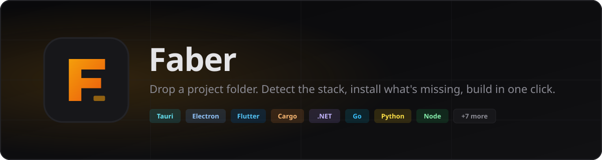
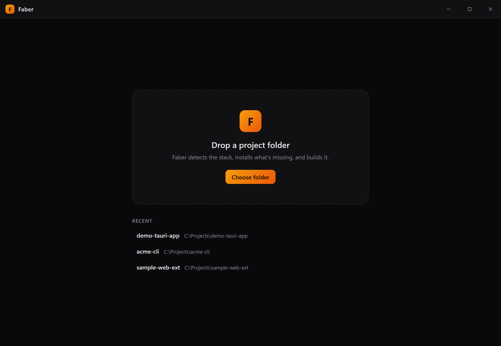
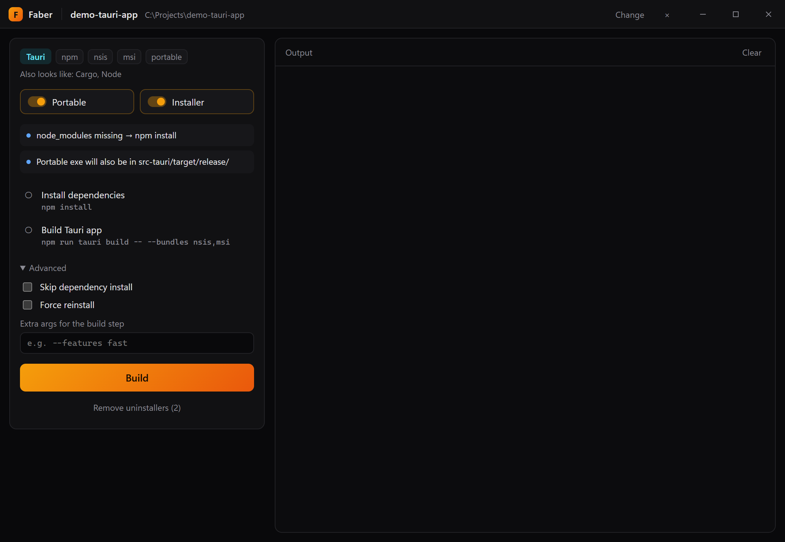
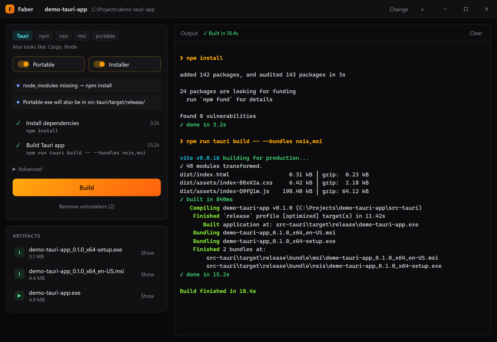
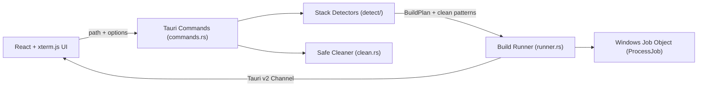

<div align="center">
  
  <h1>Faber</h1>
  <p>Pick or drop a project folder. Faber detects the stack, installs what's missing, builds it, and lists the outputs.</p>
  <p>
    
    
    
    
    <a href="https://github.com/projectGloria/Faber/actions/workflows/build-installers.yml"></a>
  </p>
</div>

<p align="center">
  
</p>

<p align="center">
  <a href="#about">About</a> ·
  <a href="#features">Features</a> ·
  <a href="#supported-stacks">Supported stacks</a> ·
  <a href="#screenshots">Screenshots</a> ·
  <a href="#how-it-works">How it works</a> ·
  <a href="#installation">Installation</a> ·
  <a href="#usage">Usage</a> ·
  <a href="#building-from-source">Building from source</a> ·
  <a href="#how-to-release">How to release</a> ·
  <a href="#tests">Tests</a> ·
  <a href="#license">License</a>
</p>

## About

Faber is a Windows desktop build runner built with Tauri v2, React 19, and Rust. Drop any local repository onto the window (or pick a folder) and Faber inspects the filesystem, picks the most specific build toolchain, explains why any dependency install step is needed, streams the live build log into an embedded terminal, and surfaces the newly produced artifacts.

Everything stays in each toolchain's native output directory; Faber never copies build outputs into a folder of its own.

## Features

- **15-stack priority detection** — Automatically identifies Tauri, Electron, Flutter, Dart, Gradle, custom build scripts, .NET, MSBuild, Cargo, Zig, Go, CMake/Make, VS Code/browser extensions, Python, and Node projects, while surfacing secondary matches as alternatives.
- **On-demand dependency installs** — Runs installs only when `node_modules` is missing, lockfiles/`package.json` are newer than the install marker, or Python dependencies require a `.venv`, and displays the exact reason in the plan card. Falls back to `corepack` or `npx --yes` when `pnpm` or `yarn` are not globally installed.
- **Live ANSI terminal & process-tree cancellation** — Streams stdout/stderr directly into an embedded `xterm.js` terminal over a Tauri v2 `Channel` without blocking the UI. Child processes run inside a Windows Job Object so clicking **Cancel** terminates the entire process tree.
- **Fresh artifact discovery** — Lists only files modified during the current run so stale binaries never appear, with one-click **Show** / **Open** actions that reveal outputs in File Explorer without executing them.
- **Safe build-folder cleanup** — **Remove uninstallers** deletes detected build output directories (`target/`, `dist/`, `bin`+`obj`, etc.) after a confirmation dialog. Rust-side validation refuses dependency folders (`node_modules`, `.venv`), VCS folders (`.git`), source directories, symlinks/junctions, and anything outside the project root.
- **Per-project preferences** — Stores up to 8 recent projects and per-folder overrides (Portable/Installer toggles, skip/force install, and extra build arguments) in `faber.json`.

## Supported stacks

| Stack | Trigger | Runs |
| --- | --- | --- |
| **Tauri** | `src-tauri/tauri.conf.json`, `app/src-tauri/...` | `<pm> tauri build` (`+ --bundles nsis,msi` unless targets are pinned); portable build is the release `.exe` in `target/release/` |
| **Electron** | `electron` + `electron-builder` | Existing `dist`/`build:win`/`package` script (with `nsis portable` appended when safe), or `electron-builder --win nsis portable` |
| **Flutter** | `pubspec.yaml` with `flutter:` | `flutter pub get` (if stale/missing) → `flutter build windows --release` (or `apk --release` / `web`) |
| **Dart** | `pubspec.yaml` without `flutter:` | `dart pub get` → `dart compile exe bin/<entry>.dart -o bin/<name>.exe` |
| **Gradle** | `build.gradle(.kts)`, `settings.gradle(.kts)`, `gradlew.bat` | `cmd /C .\gradlew.bat assembleRelease` (Android APK) or `build` (Java/Kotlin) |
| **Script** | `build.ps1`, `Build-*.ps1`, `build-*.bat`, `build-*.cmd`, `installer/build.ps1`, etc. | Runs your custom script; outranks generic stack rules |
| **.NET** | SDK-style `*.csproj` / `*.sln` | `dotnet publish -r win-x64 -p:PublishSingleFile=true` → `bin/Release/<tfm>/win-x64/publish/` |
| **VS / MSBuild** | `*.vcxproj`, legacy `*.csproj` | MSBuild (located via `vswhere`), Release x64 |
| **Cargo** | `Cargo.toml` | `cargo build --release` |
| **Zig** | `build.zig` | `zig build -Doptimize=ReleaseSafe` → `zig-out/bin/*.exe` |
| **Go** | `go.mod`, `main.go` | `go mod download` → `go build -ldflags "-s -w" -o <name>.exe .` |
| **CMake / Make** | `CMakeLists.txt`, `Makefile` | `cmake -B build` + `cmake --build build --config Release` (or `make`) |
| **Extension** | VS Code (`engines.vscode`) or WebExtension (`manifest.json`) | `<pm> run package` or `@vscode/vsce package` (`*.vsix`), or zip packaging (`*.zip`) |
| **Python** | `requirements.txt`, `.spec`, `build_exe.py`, entry `.py` | `.venv` + `pip` when deps are declared; `build_exe.py` > `.spec` > `pyinstaller --onefile` |
| **Node** | `package.json` | `<pm> run build` (WXT also runs `zip`) |

## Screenshots

<p align="center">
  
  <br /><em>Launch screen: drag and drop a project folder, browse with the native picker, or reopen a recent project.</em>
</p>

<p align="center">
  
  <br /><em>Plan detection: stack badges, target toggles, install notices, ordered build steps, and per-project advanced options.</em>
</p>

<p align="center">
  
  <br /><em>Build output: live xterm.js log with step timings and freshly produced artifacts ready to reveal in Explorer.</em>
</p>

## How it works



The webview never sends raw shell commands or delete paths to Rust. On every **Build** or **Remove uninstallers** click, the frontend passes only the project `path` and `options`, and the Rust backend re-runs detection on disk to derive the exact commands and safe cleanup targets.

## Installation

- **Tagged releases**: Download the Windows NSIS (`.exe`) or MSI (`.msi`) installer from the [Releases](https://github.com/projectGloria/Faber/releases) page.
- **Manual builds**: Trigger the **Build Installers** workflow (`workflow_dispatch`) in the **Actions** tab and download the `installers` artifact.

## Usage

1. **Open a project** — Drag a folder onto the Faber window, click **Choose folder**, or select an entry under **Recent**.
2. **Review and build** — Check the detected stack, install notices, and step list. Toggle **Portable** / **Installer** or expand **Advanced** (`Skip dependency install`, `Force reinstall`, `Extra args for the build step`), then click **Build**.
3. **Inspect or clean outputs** — Click **Show** / **Open** next to any artifact to reveal it in File Explorer, or click **Remove uninstallers** to delete detected build output folders after confirmation.

## Building from source

### Prerequisites

- **OS**: Windows 10/11 (with WebView2 runtime and Visual Studio C++ Build Tools for Tauri)
- **Node.js & npm**: Node.js with npm (project uses Vite 8 and TypeScript ~6.0)
- **Rust**: Rust toolchain supporting `edition = "2024"` (Rust 1.85+)

### Steps

1. Clone the repository:

   ```bash
   git clone https://github.com/projectGloria/Faber.git
   cd Faber
   ```

2. Install frontend dependencies:

   ```bash
   npm ci
   ```

3. Run in development mode:

   ```bash
   npm run tauri dev
   ```

4. Build release installers (NSIS & MSI):

   ```bash
   npm run tauri build
   ```

   Built installers are written to `src-tauri/target/release/bundle/nsis/` and `src-tauri/target/release/bundle/msi/`.

## How to release

1. Bump the version in `package.json`, `src-tauri/tauri.conf.json`, and `src-tauri/Cargo.toml`, then commit your changes.
2. Tag the release and push the tag:

   ```bash
   git tag v1.0.0 && git push --tags
   ```

GitHub Actions (`.github/workflows/build-installers.yml`) automatically builds the Windows NSIS (`faber-<version>-windows-x64.exe`) and MSI (`faber-<version>-windows-x64.msi`) installers, uploads them as the `installers` workflow artifact, and publishes a GitHub Release with the installers attached.

## Tests

Rust unit and integration tests cover stack detectors, safe cleanup validation, and runner execution (spawn, streaming, failure handling, and Job Object process-tree cancellation):

```bash
cd src-tauri
cargo test
```

To run the ignored dry-run detector check across sibling project directories:

```bash
cd src-tauri
cargo test real_projects -- --ignored --nocapture
```

<details>
<summary>Configuration & storage details</summary>

- **Preferences store**: Recent project paths (up to 8) and per-project option overrides are saved automatically via `@tauri-apps/plugin-store` in `faber.json` inside the app data directory (`dev.nihil.faber`).
- **Default build options**: `portable: true`, `installer: true`, `skipInstall: false`, `forceInstall: false`, `extraArgs: ""`.
- **Cleanable folders**: Re-derived on disk from the active detector and filtered by `src-tauri/src/clean.rs` to block `node_modules`, `.venv`, `venv`, `.git`, `.hg`, `.svn`, `src`, `src-tauri`, `public`, `assets`, `resources`, `icons`, symlinks/junctions, and any path escaping the project root.

</details>

## Contributing

Issues and pull requests are welcome at [projectGloria/Faber](https://github.com/projectGloria/Faber). Before submitting a PR, run `npm run build` and `cargo test` in `src-tauri/`.

## License

<!-- TODO: add a LICENSE file to the repository and update this section -->
No license file is currently present in this repository.
