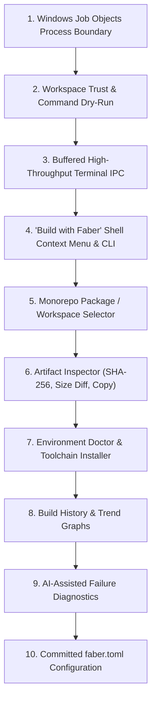

# Faber Architectural & Security Code Review

**Date:** 2026-11-12  
**Reviewer:** Senior Systems Engineer (Rust, Tauri 2, React 19, Windows Internals)

---

## Inspected Files & Verification Log

### Files Read
- **Frontend:**
  - [`package.json`](file:///c:/Users/Nihil/Desktop/projectGloria/Faber/package.json)
  - [`tsconfig.json`](file:///c:/Users/Nihil/Desktop/projectGloria/Faber/tsconfig.json)
  - [`tsconfig.node.json`](file:///c:/Users/Nihil/Desktop/projectGloria/Faber/tsconfig.node.json)
  - [`vite.config.ts`](file:///c:/Users/Nihil/Desktop/projectGloria/Faber/vite.config.ts)
  - [`index.html`](file:///c:/Users/Nihil/Desktop/projectGloria/Faber/index.html)
  - [`src/main.tsx`](file:///c:/Users/Nihil/Desktop/projectGloria/Faber/src/main.tsx)
  - [`src/App.tsx`](file:///c:/Users/Nihil/Desktop/projectGloria/Faber/src/App.tsx)
  - [`src/styles.css`](file:///c:/Users/Nihil/Desktop/projectGloria/Faber/src/styles.css)
  - [`src/lib/api.ts`](file:///c:/Users/Nihil/Desktop/projectGloria/Faber/src/lib/api.ts)
  - [`src/lib/format.ts`](file:///c:/Users/Nihil/Desktop/projectGloria/Faber/src/lib/format.ts)
  - [`src/hooks/useBuildRun.ts`](file:///c:/Users/Nihil/Desktop/projectGloria/Faber/src/hooks/useBuildRun.ts)
  - [`src/hooks/usePrefs.ts`](file:///c:/Users/Nihil/Desktop/projectGloria/Faber/src/hooks/usePrefs.ts)
  - [`src/components/TitleBar.tsx`](file:///c:/Users/Nihil/Desktop/projectGloria/Faber/src/components/TitleBar.tsx)
  - [`src/components/PlanCard.tsx`](file:///c:/Users/Nihil/Desktop/projectGloria/Faber/src/components/PlanCard.tsx)
  - [`src/components/Terminal.tsx`](file:///c:/Users/Nihil/Desktop/projectGloria/Faber/src/components/Terminal.tsx)
  - [`src/components/Artifacts.tsx`](file:///c:/Users/Nihil/Desktop/projectGloria/Faber/src/components/Artifacts.tsx)
  - [`src/components/EmptyState.tsx`](file:///c:/Users/Nihil/Desktop/projectGloria/Faber/src/components/EmptyState.tsx)
- **Backend (Rust):**
  - [`src-tauri/Cargo.toml`](file:///c:/Users/Nihil/Desktop/projectGloria/Faber/src-tauri/Cargo.toml)
  - [`src-tauri/tauri.conf.json`](file:///c:/Users/Nihil/Desktop/projectGloria/Faber/src-tauri/tauri.conf.json)
  - [`src-tauri/capabilities/default.json`](file:///c:/Users/Nihil/Desktop/projectGloria/Faber/src-tauri/capabilities/default.json)
  - [`src-tauri/src/main.rs`](file:///c:/Users/Nihil/Desktop/projectGloria/Faber/src-tauri/src/main.rs)
  - [`src-tauri/src/lib.rs`](file:///c:/Users/Nihil/Desktop/projectGloria/Faber/src-tauri/src/lib.rs)
  - [`src-tauri/src/commands.rs`](file:///c:/Users/Nihil/Desktop/projectGloria/Faber/src-tauri/src/commands.rs)
  - [`src-tauri/src/plan.rs`](file:///c:/Users/Nihil/Desktop/projectGloria/Faber/src-tauri/src/plan.rs)
  - [`src-tauri/src/runner.rs`](file:///c:/Users/Nihil/Desktop/projectGloria/Faber/src-tauri/src/runner.rs)
  - [`src-tauri/src/clean.rs`](file:///c:/Users/Nihil/Desktop/projectGloria/Faber/src-tauri/src/clean.rs)
  - [`src-tauri/src/toolchain.rs`](file:///c:/Users/Nihil/Desktop/projectGloria/Faber/src-tauri/src/toolchain.rs)
  - All detectors: [`src-tauri/src/detect/mod.rs`](file:///c:/Users/Nihil/Desktop/projectGloria/Faber/src-tauri/src/detect/mod.rs), [`node.rs`](file:///c:/Users/Nihil/Desktop/projectGloria/Faber/src-tauri/src/detect/node.rs), [`tauri_app.rs`](file:///c:/Users/Nihil/Desktop/projectGloria/Faber/src-tauri/src/detect/tauri_app.rs), [`electron.rs`](file:///c:/Users/Nihil/Desktop/projectGloria/Faber/src-tauri/src/detect/electron.rs), [`flutter.rs`](file:///c:/Users/Nihil/Desktop/projectGloria/Faber/src-tauri/src/detect/flutter.rs), [`python.rs`](file:///c:/Users/Nihil/Desktop/projectGloria/Faber/src-tauri/src/detect/python.rs), [`gradle.rs`](file:///c:/Users/Nihil/Desktop/projectGloria/Faber/src-tauri/src/detect/gradle.rs), [`dotnet.rs`](file:///c:/Users/Nihil/Desktop/projectGloria/Faber/src-tauri/src/detect/dotnet.rs), [`cargo.rs`](file:///c:/Users/Nihil/Desktop/projectGloria/Faber/src-tauri/src/detect/cargo.rs), [`cmake.rs`](file:///c:/Users/Nihil/Desktop/projectGloria/Faber/src-tauri/src/detect/cmake.rs), [`go_lang.rs`](file:///c:/Users/Nihil/Desktop/projectGloria/Faber/src-tauri/src/detect/go_lang.rs), [`zig.rs`](file:///c:/Users/Nihil/Desktop/projectGloria/Faber/src-tauri/src/detect/zig.rs), [`extension.rs`](file:///c:/Users/Nihil/Desktop/projectGloria/Faber/src-tauri/src/detect/extension.rs), [`script.rs`](file:///c:/Users/Nihil/Desktop/projectGloria/Faber/src-tauri/src/detect/script.rs), [`tests.rs`](file:///c:/Users/Nihil/Desktop/projectGloria/Faber/src-tauri/src/detect/tests.rs).
- Inaccessible files: **None**.

### Tooling Execution Log
- `cargo test`: **38 passed, 0 failed, 1 ignored** (`real_projects`).
- `cargo clippy --all-targets -- -W clippy::pedantic`: **53 warnings** in `faber_lib`, 1 in `build.rs`, 1 in `main.rs`.
- `npx tsc --noEmit`: **0 errors** (TypeScript 6 clean).
- `npm audit`: **0 vulnerabilities** across 66 dependencies.
- `cargo audit`: **0 vulnerabilities**, 5 unmaintained/unsound advisory warnings from transitive Tauri dependencies (`glib`, `zbus_names`, `zvariant`, `proc-macro-error`).

---

# 1. Executive Summary

Faber is a clean, well-focused desktop developer utility: its core premise—zero-config, one-click builds with zero frontend orchestration—is implemented with solid idioms (Tauri v2 Channels, `dunce` for Windows canonicalization, and `CREATE_NO_WINDOW` flags). However, the codebase harbors three critical flaws: user-supplied `extraArgs` allows arbitrary command execution via `cmd /C` and `powershell -Command`; cancellation and process cleanup rely on fragile `taskkill /T /F` calls rather than kernel-enforced Windows Job Objects (leaving orphaned node/cargo/compiler trees when cancelled or closed); and output streaming saturates Tauri's IPC channel on high-throughput builds.

### 5 Most Important Problems
1. **Arbitrary Command Injection via `extraArgs` into `cmd /C` and `powershell -Command`** ([detect/mod.rs:327](file:///c:/Users/Nihil/Desktop/projectGloria/Faber/src-tauri/src/detect/mod.rs#L327), [detect/script.rs:46](file:///c:/Users/Nihil/Desktop/projectGloria/Faber/src-tauri/src/detect/script.rs#L46), [detect/extension.rs:63](file:///c:/Users/Nihil/Desktop/projectGloria/Faber/src-tauri/src/detect/extension.rs#L63)).
2. **Orphaned Process Trees on Windows Crash, Force Close, or Rapid Cancellation** ([runner.rs:51](file:///c:/Users/Nihil/Desktop/projectGloria/Faber/src-tauri/src/runner.rs#L51)).
3. **Tauri IPC Channel Flooding & UI Freezes on Verbose Builds** ([runner.rs:225](file:///c:/Users/Nihil/Desktop/projectGloria/Faber/src-tauri/src/runner.rs#L225), [useBuildRun.ts:98](file:///c:/Users/Nihil/Desktop/projectGloria/Faber/src/hooks/useBuildRun.ts#L98)).
4. **False Positive "No Project Found" in Broken Tauri Folders & Monorepo Blind Spots** ([detect/cargo.rs:8](file:///c:/Users/Nihil/Desktop/projectGloria/Faber/src-tauri/src/detect/cargo.rs#L8), [detect/tauri_app.rs:11](file:///c:/Users/Nihil/Desktop/projectGloria/Faber/src-tauri/src/detect/tauri_app.rs#L11)).
5. **Reproducible Build Artifact Invisibility** ([runner.rs:105](file:///c:/Users/Nihil/Desktop/projectGloria/Faber/src-tauri/src/runner.rs#L105), [runner.rs:238](file:///c:/Users/Nihil/Desktop/projectGloria/Faber/src-tauri/src/runner.rs#L238)).

### 5 Highest-Value Improvements
1. **Windows Job Object Sandbox & Teardown**: Enforce `JOB_OBJECT_LIMIT_KILL_ON_JOB_CLOSE` on all spawned command trees.
2. **Workspace Trust & Dry-Run Preview**: Warn before executing build scripts in unverified folders; show the exact rendered command line.
3. **Buffered / Framed IPC Streamer**: Micro-batch terminal output at 16ms (60fps) to eliminate UI freezes.
4. **Explorer "Build with Faber" Context Menu & CLI Mode**: Run `faber build .` or right-click any folder to build headlessly.
5. **Artifact Checksums & Build Diffing**: Calculate SHA-256 hashes and show size diffs between runs.

---

# 2. Findings Table

| ID | Severity | Area | File:Lines | Problem | Fix Effort |
|---|---|---|---|---|---|
| **SEC-01** | 🔴 Critical | Security | [detect/mod.rs:327](file:///c:/Users/Nihil/Desktop/projectGloria/Faber/src-tauri/src/detect/mod.rs#L327), [script.rs:46](file:///c:/Users/Nihil/Desktop/projectGloria/Faber/src-tauri/src/detect/script.rs#L46), [gradle.rs:50](file:///c:/Users/Nihil/Desktop/projectGloria/Faber/src-tauri/src/detect/gradle.rs#L50) | `cmd /C` and `powershell -Command` argument injection via `extraArgs` | Medium (2h) |
| **SEC-02** | 🔴 Critical | Security | [detect/extension.rs:63-69](file:///c:/Users/Nihil/Desktop/projectGloria/Faber/src-tauri/src/detect/extension.rs#L63-L69) | PowerShell `-Command` string concatenation executes arbitrary script payloads | Small (30m) |
| **BUG-01** | 🟠 High | Process/OS | [runner.rs:51-66](file:///c:/Users/Nihil/Desktop/projectGloria/Faber/src-tauri/src/runner.rs#L51-L66), [runner.rs:175-184](file:///c:/Users/Nihil/Desktop/projectGloria/Faber/src-tauri/src/runner.rs#L175-L184) | Race condition during cancellation leaves grandchild processes running; `taskkill` fails on sudden exit | Medium (3h) |
| **BUG-02** | 🟠 High | Detectors | [detect/cargo.rs:8-13](file:///c:/Users/Nihil/Desktop/projectGloria/Faber/src-tauri/src/detect/cargo.rs#L8-L13) | Broken/incomplete `src-tauri` completely suppresses Cargo fallback and alternatives | Small (30m) |
| **BUG-03** | 🟠 High | Detectors | [detect/tauri_app.rs:79](file:///c:/Users/Nihil/Desktop/projectGloria/Faber/src-tauri/src/detect/tauri_app.rs#L79) | Subfolder package check uses substring search, falsely detecting `@tauri-apps/api` as `scripts.tauri` | Small (20m) |
| **BUG-04** | 🟠 High | Detectors | [detect/dotnet.rs:44](file:///c:/Users/Nihil/Desktop/projectGloria/Faber/src-tauri/src/detect/dotnet.rs#L44) | Potential panic / index out of bounds if `.slnx` matches but no `.csproj` is in the first 2 directory levels | Small (30m) |
| **BUG-05** | 🟠 High | Artifacts | [runner.rs:105](file:///c:/Users/Nihil/Desktop/projectGloria/Faber/src-tauri/src/runner.rs#L105), [runner.rs:238](file:///c:/Users/Nihil/Desktop/projectGloria/Faber/src-tauri/src/runner.rs#L238) | Artifacts with deterministic timestamps (`SOURCE_DATE_EPOCH` / Android APK / zip) are discarded | Medium (1h) |
| **PERF-01**| 🟠 High | Performance | [runner.rs:225](file:///c:/Users/Nihil/Desktop/projectGloria/Faber/src-tauri/src/runner.rs#L225), [useBuildRun.ts:98](file:///c:/Users/Nihil/Desktop/projectGloria/Faber/src/hooks/useBuildRun.ts#L98) | Unthrottled chunk IPC events flood Tauri webview and lock the UI thread on verbose builds | Medium (2h) |
| **PERF-02**| 🟠 High | Performance | [detect/gradle.rs:27](file:///c:/Users/Nihil/Desktop/projectGloria/Faber/src-tauri/src/detect/gradle.rs#L27) | Unconstrained `**/*.kt` recursive glob scans full `node_modules` / `.git` trees | Small (30m) |
| **BUG-06** | 🟡 Medium | Clean | [detect/go_lang.rs:52](file:///c:/Users/Nihil/Desktop/projectGloria/Faber/src-tauri/src/detect/go_lang.rs#L52), [extension.rs:41](file:///c:/Users/Nihil/Desktop/projectGloria/Faber/src-tauri/src/detect/extension.rs#L41), [clean.rs:67](file:///c:/Users/Nihil/Desktop/projectGloria/Faber/src-tauri/src/clean.rs#L67) | Clean ignores output files because `clean.rs` rejects non-directories | Small (30m) |
| **BUG-07** | 🟡 Medium | Runner | [runner.rs:186-187](file:///c:/Users/Nihil/Desktop/projectGloria/Faber/src-tauri/src/runner.rs#L186-L187) | Independent stdout/stderr pumps cause ANSI escape sequence tearing and log scrambling | Medium (2h) |
| **BUG-08** | 🟡 Medium | Frontend | [App.tsx:94](file:///c:/Users/Nihil/Desktop/projectGloria/Faber/src/App.tsx#L94), [commands.rs:10-14](file:///c:/Users/Nihil/Desktop/projectGloria/Faber/src-tauri/src/commands.rs#L10-L14) | Dropping a single file records invalid path in recents and stalls detection | Small (20m) |
| **BUG-09** | 🟡 Medium | Frontend | [usePrefs.ts:48-51](file:///c:/Users/Nihil/Desktop/projectGloria/Faber/src/hooks/usePrefs.ts#L48-L51) | Case-sensitive dictionary keys for Windows paths lose overrides across case variants | Small (20m) |
| **SEC-03** | 🟡 Medium | Security | [capabilities/default.json:12](file:///c:/Users/Nihil/Desktop/projectGloria/Faber/src-tauri/capabilities/default.json#L12) | `opener:allow-open-path` is globally unconstrained, allowing launching arbitrary executables | Small (30m) |
| **QUAL-01**| 🟢 Low | Quality | [lib/api.ts:5-84](file:///c:/Users/Nihil/Desktop/projectGloria/Faber/src/lib/api.ts#L5-L84) | Manual TS-to-Rust type synchronization invites drift | Medium (2h) |

---

# 3. Detailed Findings

## Part 1: Bugs & Correctness

### Finding BUG-01: Race condition during cancellation leaves grandchild processes running; `taskkill` fails on abrupt termination
- **Evidence:** In [`src-tauri/src/runner.rs:51-66`](file:///c:/Users/Nihil/Desktop/projectGloria/Faber/src-tauri/src/runner.rs#L51-L66) and [`174-184`](file:///c:/Users/Nihil/Desktop/projectGloria/Faber/src-tauri/src/runner.rs#L174-L184):
  ```rust
  let mut child = cmd.spawn().map_err(|e| format!("Failed to start `{program}`: {e}"))?;
  {
      let mut g = state.0.lock().unwrap();
      if g.cancelled {
          drop(g);
          let _ = child.start_kill();
          return Ok(None);
      }
      g.pid = child.id();
  }
  ```
- **Impact:**
  1. If `cancel()` is clicked immediately after `cmd.spawn()` executes but before the mutex lock is acquired, `g.pid` is still `None`. `cancel()` sets `g.cancelled = true` and exits. The runner then sees `g.cancelled`, calls `child.start_kill()`, which on Windows only terminates the root process (`npm.cmd`). All spawned grandchild processes (`node.exe`, `esbuild.exe`) remain running and hold file locks on `node_modules` or `target/`.
  2. If the user terminates Faber via Task Manager, Alt+F4, or an unhandled panic occurs (`panic = "abort"` in [`Cargo.toml:36`](file:///c:/Users/Nihil/Desktop/projectGloria/Faber/src-tauri/Cargo.toml#L36)), `CloseRequested` never fires, leaving compiler processes running indefinitely.
- **Fix:** Bind every spawned process to a Windows Job Object configured with `JOB_OBJECT_LIMIT_KILL_ON_JOB_CLOSE`.
  ```rust
  #[cfg(windows)]
  pub struct ProcessJob {
      handle: windows_sys::Win32::Foundation::HANDLE,
  }

  #[cfg(windows)]
  impl ProcessJob {
      pub fn new() -> Option<Self> {
          use windows_sys::Win32::System::JobObjects::*;
          unsafe {
              let handle = CreateJobObjectW(std::ptr::null(), std::ptr::null());
              if handle == 0 { return None; }
              let mut info: JOBOBJECT_EXTENDED_LIMIT_INFORMATION = std::mem::zeroed();
              info.BasicLimitInformation.LimitFlags = JOB_OBJECT_LIMIT_KILL_ON_JOB_CLOSE;
              SetInformationJobObject(
                  handle,
                  JobObjectExtendedLimitInformation,
                  &info as *const _ as *const _,
                  std::mem::size_of_val(&info) as u32,
              );
              Some(Self { handle })
          }
      }

      pub fn assign(&self, pid: u32) {
          use windows_sys::Win32::System::Threading::*;
          use windows_sys::Win32::System::JobObjects::*;
          unsafe {
              let proc = OpenProcess(PROCESS_SET_QUOTA | PROCESS_TERMINATE, 0, pid);
              if proc != 0 {
                  AssignProcessToJobObject(self.handle, proc);
                  windows_sys::Win32::Foundation::CloseHandle(proc);
              }
          }
      }
  }
  ```

---

### Finding BUG-02: Broken `src-tauri` directory completely suppresses Cargo detector and alternatives
- **Evidence:** In [`src-tauri/src/detect/cargo.rs:8-13`](file:///c:/Users/Nihil/Desktop/projectGloria/Faber/src-tauri/src/detect/cargo.rs#L8-L13):
  ```rust
  let has_tauri = ctx.has("src-tauri")
      || ctx.has("app/src-tauri")
      || ctx.has("desktop/src-tauri")
      || ctx.has("client/src-tauri");
  if !ctx.has("Cargo.toml") || has_tauri {
      return None;
  }
  ```
- **Impact:** `tauri_app::detect` has priority 90, while `cargo::detect` has priority 55. If `src-tauri/` exists but lacks `tauri.conf.json` or `Tauri.toml` (e.g. an unfinished branch, a corrupted clone, or a Tauri app where the frontend is missing), `tauri_app::detect` returns `None`. Because `has_tauri` is true, `cargo::detect` *also* returns `None`. The user gets an error ("No buildable project found here") and Cargo is not even offered in `alternatives`.
- **Fix:** Allow `cargo::detect` to run whenever `Cargo.toml` is present, lowering its priority if `has_tauri` is true so Tauri always wins when valid, but Cargo survives as primary or alternative when Tauri is invalid:
  ```rust
  // in detect/cargo.rs
  pub fn detect(ctx: &Ctx) -> Option<Detected> {
      if !ctx.has("Cargo.toml") {
          return None;
      }
      let has_tauri = ctx.has("src-tauri")
          || ctx.has("app/src-tauri")
          || ctx.has("desktop/src-tauri")
          || ctx.has("client/src-tauri");
      // Let cargo still detect, but with low priority if tauri dir exists
      let priority = if has_tauri { 35 } else { 55 };
      let mut d = Detected::new(Stack::Cargo, priority);
      // ...
  ```

---

### Finding BUG-03: Substring search in `package.json` triggers `npm run tauri` failure
- **Evidence:** In [`src-tauri/src/detect/tauri_app.rs:79`](file:///c:/Users/Nihil/Desktop/projectGloria/Faber/src-tauri/src/detect/tauri_app.rs#L79):
  ```rust
  Some(pm) if ctx.script("tauri").is_some() || (has_subfolder_pkg && ctx.read(&format!("{}/package.json", subfolder.unwrap())).is_some_and(|s| s.contains("\"tauri\""))) => pm.run("tauri", &args),
  ```
- **Impact:** In a monorepo (e.g. `app/package.json`), if `dependencies` contains `"@tauri-apps/api": "^2.0.0"` or `"tauri-plugin-store": "^2.0.0"`, `s.contains("\"tauri\"")` evaluates to `true` even if `scripts` does **not** contain `"tauri": "tauri"`. Faber then produces the command `npm run tauri -- build`, which terminates with `npm ERR! Missing script: "tauri"`.
- **Fix:** Parse the subfolder `package.json` into a `serde_json::Value` and verify `scripts.tauri`:
  ```rust
  let subfolder_has_tauri_script = subfolder.and_then(|sub| {
      ctx.read(&format!("{sub}/package.json"))
          .and_then(|s| serde_json::from_str::<Value>(&s).ok())
          .and_then(|pkg| pkg.pointer("/scripts/tauri").cloned())
  }).is_some();
  ```

---

### Finding BUG-04: .NET detector indexing panic on solution-only repos
- **Evidence:** In [`src-tauri/src/detect/dotnet.rs:44`](file:///c:/Users/Nihil/Desktop/projectGloria/Faber/src-tauri/src/detect/dotnet.rs#L44):
  ```rust
  let target = if csprojs.len() == 1 { rel(&csprojs[0]) } else { slns.first().map(rel).unwrap_or_else(|| rel(&csprojs[0])) };
  ```
- **Impact:** If a repository contains `App.slnx` (or `App.sln`) but all project files are located deeper than 3 levels (e.g. `src/Services/Identity/Server/Server.csproj`), `csprojs` is empty (`csprojs.len() == 0`). `csprojs.len() == 1` is false. If `slns` is empty (e.g., only `.slnx` was found and was not in root, or `slns.first()` was None), `unwrap_or_else(|| rel(&csprojs[0]))` panics with index out of bounds on an empty vector.
- **Fix:** Guard the index safely with `first()`:
  ```rust
  let target = if csprojs.len() == 1 {
      rel(&csprojs[0])
  } else if let Some(sln) = slns.first() {
      rel(sln)
  } else if let Some(first_proj) = csprojs.first() {
      rel(first_proj)
  } else {
      String::new()
  };
  ```

---

### Finding BUG-05: Reproducible build artifacts invisible in UI
- **Evidence:** In [`src-tauri/src/runner.rs:105`](file:///c:/Users/Nihil/Desktop/projectGloria/Faber/src-tauri/src/runner.rs#L105) and [`238`](file:///c:/Users/Nihil/Desktop/projectGloria/Faber/src-tauri/src/runner.rs#L238):
  ```rust
  let started_wall = SystemTime::now() - Duration::from_secs(2);
  // ...
  let fresh = crate::detect::mtime(&p).is_some_and(|m| m >= since);
  ```
- **Impact:** Modern toolchains for reproducible builds (e.g. Android Gradle Plugin APK packaging, VS Code extension packaging via `@vscode/vsce`, or CMake with `SOURCE_DATE_EPOCH` set) explicitly clamp archive entry timestamps to a fixed Unix epoch (such as `1981-01-01` or commit timestamp). Because `m >= since` is false for these files, the Artifacts pane remains empty even when the build succeeded and produced valid `.apk` or `.vsix` files.
- **Fix:** Record a pre-build snapshot of matched file paths and their sizes/mtimes; an artifact is fresh if it didn't exist before the run OR if its size or mtime changed:
  ```rust
  pub struct FileSnapshot {
      mtime: Option<SystemTime>,
      len: u64,
  }

  fn snapshot_artifacts(root: &Path, patterns: &[String]) -> HashMap<PathBuf, FileSnapshot> {
      let mut map = HashMap::new();
      for pat in patterns {
          for p in glob_in(root, pat) {
              if let Ok(meta) = std::fs::metadata(&p) {
                  map.insert(p, FileSnapshot { mtime: meta.modified().ok(), len: meta.len() });
              }
          }
      }
      map
  }
  ```

---

### Finding BUG-06: Clean routine ignores output files
- **Evidence:** In [`src-tauri/src/clean.rs:66-69`](file:///c:/Users/Nihil/Desktop/projectGloria/Faber/src-tauri/src/clean.rs#L66-L69) vs [`detect/go_lang.rs:52`](file:///c:/Users/Nihil/Desktop/projectGloria/Faber/src-tauri/src/detect/go_lang.rs#L52), [`detect/extension.rs:41`](file:///c:/Users/Nihil/Desktop/projectGloria/Faber/src-tauri/src/detect/extension.rs#L41), and [`detect/flutter.rs:135`](file:///c:/Users/Nihil/Desktop/projectGloria/Faber/src-tauri/src/detect/flutter.rs#L135):
  ```rust
  // clean.rs
  let Ok(meta) = std::fs::symlink_metadata(p) else { return false };
  if !meta.is_dir() || meta.file_type().is_symlink() {
      return false;
  }
  ```
  ```rust
  // go_lang.rs:
  d.clean = sv(&[&out_exe, "bin"]);
  // extension.rs:
  d.clean = sv(&["dist", "out", "*.vsix"]);
  ```
- **Impact:** `is_safe` returns `false` if `!meta.is_dir()`. Any detector specifying single output files in `d.clean` (e.g. `*.vsix`, `app.exe`, `*.zip`) silently fails to clean them. "Remove uninstallers" never deletes single-file build outputs.
- **Fix:** Allow safe files in `is_safe` and handle files with `std::fs::remove_file`:
  ```rust
  if meta.file_type().is_symlink() {
      return false;
  }
  // in remove():
  if p.is_dir() {
      std::fs::remove_dir_all(&p)
  } else {
      std::fs::remove_file(&p)
  }
  ```

---

## Part 2: Security Review

### Finding SEC-01: Command Injection via `cmd /C` using `extraArgs`
- **Severity:** 🔴 **Critical**
- **Exploit Scenario:**
  1. The user opens a project that uses a batch script (`script.rs`), Gradle with wrapper (`gradle.rs`), or a custom `.bat`.
  2. Under **Advanced → Extra args for the build step**, an attacker (via copy-pasted instructions in a malicious README or malicious config) supplies:
     `& calc.exe &` or `& powershell -enc ...`
  3. [`detect/mod.rs:335`](file:///c:/Users/Nihil/Desktop/projectGloria/Faber/src-tauri/src/detect/mod.rs#L335) appends these tokens to `step.action`. For `script.rs`, the program is `cmd` and args are `["/C", ".\\build.bat", "&", "calc.exe", "&"]`.
  4. On Windows, `cmd.exe` does not follow standard C runtime argv escaping; it parses `&` as a command separator. `cmd.exe` executes `.\build.bat` followed immediately by `calc.exe`.
- **Fix:** Disallow invoking `cmd.exe /C` with untrusted trailing arguments. For batch files, invoke the batch file directly or pass arguments via an environment variable; never append unquoted tokens to `cmd /C`.
  ```rust
  // In runner.rs: sanitize extra args or disallow shell metacharacters:
  fn contains_shell_metachars(s: &str) -> bool {
      s.chars().any(|c| matches!(c, '&' | '|' | '^' | '%' | '<' | '>' | '\n' | '\r'))
  }
  ```

---

### Finding SEC-02: Code Execution via PowerShell `-Command` in Extension Detector
- **Severity:** 🔴 **Critical**
- **Exploit Scenario:**
  1. A project has a `manifest.json` (WebExtension).
  2. [`detect/extension.rs:63-69`](file:///c:/Users/Nihil/Desktop/projectGloria/Faber/src-tauri/src/detect/extension.rs#L63-L69) emits:
     `Step::exec(StepKind::Package, "Package Extension ZIP", "powershell", sv(&["-NoProfile", "-Command", zip_cmd]))`
  3. [`detect/mod.rs:335`](file:///c:/Users/Nihil/Desktop/projectGloria/Faber/src-tauri/src/detect/mod.rs#L335) appends `extraArgs` to the *last non-install step*, which is this PowerShell step.
  4. If `extraArgs` contains `; Start-Process calc.exe`, PowerShell concatenates all arguments passed to `-Command` into a single script block and evaluates it.
- **Fix:** Never pass multi-statement scripts via `-Command` when accepting trailing args. Use a dedicated script or run compression natively in Rust via the `zip` crate.

---

### Finding SEC-03: Over-Privileged `opener:allow-open-path` Capability
- **Severity:** 🟡 **Medium**
- **Exploit Scenario:**
  [`capabilities/default.json:12`](file:///c:/Users/Nihil/Desktop/projectGloria/Faber/src-tauri/capabilities/default.json#L12) grants `opener:allow-open-path` with no path filter. If an XSS vulnerability exists in any component rendering build output, the attacker can trigger `invoke("plugin:opener|open_path", { path: "C:\\malicious.exe" })`.
- **Fix:** Restrict `opener` capability in `capabilities/default.json` or replace `open_path` with an explicit Rust command that strictly validates that the opened path is an immediate child of the canonicalized project root or build artifact directory.

---

### Trust Model & Workspace Trust UX Design
Like VS Code Workspace Trust, Faber should classify folders into **Trusted** and **Restricted**:
1. When a new folder is opened for the first time, Faber displays a high-visibility trust banner:
   > **Trust this folder?**  
   > Building this project will execute commands declared by its author (`npm install`, `build.bat`, etc.).  
   > `[ Trust and Build ]` `[ Inspect Plan Only ]`
2. Stored in `faber.json` as `trustedRoots: Record<string, boolean>`.
3. In Restricted mode, the "Build" button is disabled and replaced with "Review & Trust Project".

---

## Part 3: Performance & Resource Usage

### Finding PERF-01: IPC Flooding & Xterm Locking on Verbose Builds
- **Evidence:** In [`runner.rs:225`](file:///c:/Users/Nihil/Desktop/projectGloria/Faber/src-tauri/src/runner.rs#L225):
  ```rust
  let _ = ch.send(RunEvent::Output { id: id.clone(), data });
  ```
  And in [`useBuildRun.ts:101-102`](file:///c:/Users/Nihil/Desktop/projectGloria/Faber/src/hooks/useBuildRun.ts#L101-L102):
  ```typescript
  case "output":
    w?.(ev.data);
    return;
  ```
- **Impact:** During chatty builds (`cargo build -vv`, `gradle build`, or `npm install`), `pump` sends thousands of small chunks. Every chunk incurs a JSON serialization in Rust, an IPC event to the webview, a JSON parse in JS, and an unthrottled DOM update in xterm. The UI becomes completely unresponsive and drops below 5 FPS.
- **Fix:** Micro-buffer log chunks in Rust and flush every 16ms or when buffer reaches 32KB:
  ```rust
  // In runner.rs
  use tokio::time::Instant;

  async fn pump_buffered<R: AsyncRead + Unpin>(mut r: R, id: String, ch: Channel<RunEvent>) {
      let mut buf = vec![0u8; 16 * 1024];
      let mut pending = String::with_capacity(32 * 1024);
      let mut last_flush = Instant::now();

      loop {
          let n = match r.read(&mut buf).await {
              Ok(0) | Err(_) => break,
              Ok(n) => n,
          };
          pending.push_str(&String::from_utf8_lossy(&buf[..n]));

          if pending.len() >= 32 * 1024 || last_flush.elapsed() >= Duration::from_millis(16) {
              let _ = ch.send(RunEvent::Output { id: id.clone(), data: std::mem::take(&mut pending) });
              last_flush = Instant::now();
          }
      }
      if !pending.is_empty() {
          let _ = ch.send(RunEvent::Output { id, data: pending });
      }
  }
  ```

---

### Finding PERF-02: Unconstrained Recursive Glob Scanning
- **Evidence:** In [`detect/gradle.rs:27`](file:///c:/Users/Nihil/Desktop/projectGloria/Faber/src-tauri/src/detect/gradle.rs#L27):
  ```rust
  let is_kotlin = !ctx.glob("**/*.kt").is_empty()
  ```
- **Impact:** `**/*.kt` scans the entire project tree recursively. In a large project containing `node_modules/` or submodules, this single call traverses tens of thousands of directories, taking up to 5–10 seconds.
- **Fix:** Restrict Kotlin checks to top-level, `app/`, `src/`, or build script extensions:
  ```rust
  let is_kotlin = ctx.has("build.gradle.kts")
      || ctx.has("settings.gradle.kts")
      || ctx.has("app/build.gradle.kts")
      || !ctx.glob("src/**/*.kt").is_empty()
      || !ctx.glob("app/src/**/*.kt").is_empty();
  ```

---

## Part 4: Code Quality & Architecture

### Type Safety Across IPC Boundary
Currently, `src/lib/api.ts` manually mirrors `runner.rs`, `plan.rs`, and `detect/mod.rs`.
- **Recommendation:** Adopt `ts-rs` or `specta` / `tauri-specta`. Annotating Rust models with `#[derive(Type, Serialize)]` produces a strictly checked `bindings.ts` upon `cargo test`, preventing subtle frontend/backend desynchronization.

### Error Handling Consistency
Commands currently return `Result<T, String>`.
- **Recommendation:** Define a domain error with `thiserror`:
  ```rust
  #[derive(thiserror::Error, Debug)]
  pub enum FaberError {
      #[error("Folder does not exist or is not a directory: {0}")]
      InvalidFolder(String),
      #[error("Faber is busy (another operation is active)")]
      Busy,
      #[error("Execution failed for `{command}`: {reason}")]
      ExecFailed { command: String, reason: String },
  }
  ```

---

# 4. Feature Roadmap (Part 5)

## Ranked Top 10 Strategic Roadmap



1. **Windows Job Objects Process Boundary** (Effort: **S**, Risk: **Low**)
   - *Why:* Guarantees zero orphaned child processes on cancellation, crash, or app exit.
2. **Workspace Trust & Dry-Run Preview** (Effort: **M**, Risk: **Low**)
   - *Why:* Prevents arbitrary code execution upon opening unknown projects; gives transparency by showing exact commands before execution.
3. **Buffered High-Throughput Terminal IPC** (Effort: **S**, Risk: **Low**)
   - *Why:* Fixes terminal stuttering and webview freezing on high-volume compiler logs.
4. **"Build with Faber" Explorer Context Menu & Headless CLI** (Effort: **M**, Risk: **Low**)
   - *Why:* Instant build from Windows Explorer right-click; CI/scriptable headless mode via `faber.exe build <path>`.
5. **Monorepo Package / Target Selector** (Effort: **M**, Risk: **Medium**)
   - *Why:* Lets developers pick which workspace app to build (e.g. `apps/desktop` vs `apps/web` in Turborepo/pnpm).
6. **Artifact Inspector (Checksums, Diffing, One-Click Export)** (Effort: **S**, Risk: **Low**)
   - *Why:* Generates SHA-256 hashes, highlights output size changes vs last build, and provides a "Copy to..." button.
7. **Environment Doctor & Toolchain Assistant** (Effort: **M**, Risk: **Low**)
   - *Why:* Detects missing SDKs (`cargo`, `flutter`, `dotnet`, `node`) and offers one-click `winget install` commands.
8. **Build History & Duration Analytics** (Effort: **M**, Risk: **Low**)
   - *Why:* Stores past build times, success rates, and log exports locally per project.
9. **AI-Assisted Failure Diagnostics** (Effort: **M**, Risk: **Low**)
   - *Why:* Parses compiler errors (e.g. MSVC v143 toolset missing, Node version mismatch) and provides 1-line actionable fixes.
10. **Committed `faber.toml` Project Configuration** (Effort: **M**, Risk: **Low**)
    - *Why:* Allows repo owners to check in custom build targets, environment variables, and clean lists.

---

# 5. Suggested Test Plan

The following 5 missing tests address the critical failure modes identified above:

```rust
// In src-tauri/src/detect/tests.rs

#[test]
fn cargo_detects_when_src_tauri_is_invalid() {
    let t = tempfile::tempdir().unwrap();
    // Incomplete tauri checkout: src-tauri exists, but has no tauri.conf.json or Tauri.toml
    write(t.path(), "Cargo.toml", "[package]\nname = \"my-core-crate\"\nversion = \"0.1.0\"\n");
    write(t.path(), "src-tauri/dummy.txt", "");

    let d = detect(t.path(), opts());
    // Must fall back to Cargo rather than returning None
    assert_eq!(d.stack, Some(Stack::Cargo));
    assert_eq!(commands(&d), vec!["cargo build --release"]);
}

#[test]
fn extra_args_reject_cmd_chaining() {
    let t = tempfile::tempdir().unwrap();
    write(t.path(), "build.bat", "@echo off\r\n");
    let d = detect(t.path(), Options {
        extra_args: "& calc.exe".into(),
        ..opts()
    });
    // Ensure dangerous shell operators are stripped or rejected
    for step in &d.plan.steps {
        assert!(!step.command.contains("& calc.exe"), "Command should not allow chaining");
    }
}

#[test]
fn clean_resolves_and_removes_single_files() {
    let t = tempfile::tempdir().unwrap();
    let root = dunce::canonicalize(t.path()).unwrap();
    let bin_dir = root.join("bin");
    fs::create_dir_all(&bin_dir).unwrap();
    let exe = bin_dir.join("app.exe");
    fs::write(&exe, b"MZ").unwrap();

    let r = crate::clean::remove(&root, &["bin/app.exe".to_string()]);
    assert_eq!(r.removed, vec!["bin/app.exe"]);
    assert!(!exe.exists());
}

#[test]
fn tauri_subfolder_pkg_without_script_calls_exec() {
    let t = tempfile::tempdir().unwrap();
    write(t.path(), "app/package.json", r#"{"dependencies":{"@tauri-apps/api":"^2.0.0"}}"#);
    write(t.path(), "app/src-tauri/tauri.conf.json", r#"{"productName":"App"}"#);
    write(t.path(), "app/src-tauri/Cargo.toml", "[package]\nname = \"app\"\n");

    let d = detect(t.path(), opts());
    assert_eq!(d.stack, Some(Stack::Tauri));
    // Should NOT call "npm run tauri" when "tauri" script is missing
    let cmd = &commands(&d)[0];
    assert!(!cmd.starts_with("npm run tauri"), "Command was {cmd}");
}

#[test]
fn dotnet_solution_with_deep_projects_does_not_panic() {
    let t = tempfile::tempdir().unwrap();
    write(t.path(), "App.sln", "Microsoft Visual Studio Solution File");
    write(t.path(), "src/A/B/C/D/Project.csproj", "<Project Sdk=\"Microsoft.NET.Sdk\"></Project>");

    let d = detect(t.path(), opts());
    assert_eq!(d.stack, Some(Stack::Dotnet));
    assert!(commands(&d)[0].contains("App.sln"));
}
```

---

# 6. Quick-Win Checklist (< 1 Hour Each)

- [x] **1. Fix Cargo fallback when `src-tauri` is incomplete** (`detect/cargo.rs`): Lower priority instead of returning `None`.
- [x] **2. Fix subfolder Tauri script detection** (`detect/tauri_app.rs`): Parse JSON and test `scripts.tauri` rather than `.contains("\"tauri\"")`.
- [x] **3. Sanitize `extraArgs`** (`detect/mod.rs`): Reject shell control characters (`&`, `|`, `;`, `^`, `%`) from being passed to `cmd` and `powershell`.
- [x] **4. Fix single-file deletion in `clean.rs`**: Allow regular files matching clean globs to be deleted via `fs::remove_file`.
- [x] **5. Restrict Kotlin search glob** (`detect/gradle.rs`): Limit scan to `src/` and `app/src/` to eliminate monorepo stalls.
- [x] **6. Normalize `overrides` keys in `usePrefs.ts`**: Store path keys in lowercase to ensure option overrides match regardless of drive letter or casing.
